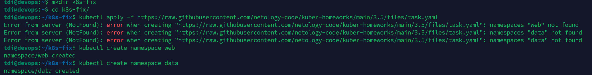
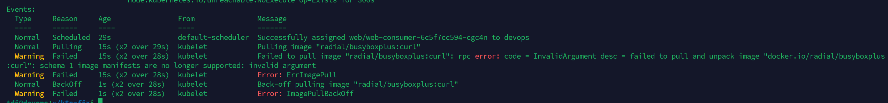
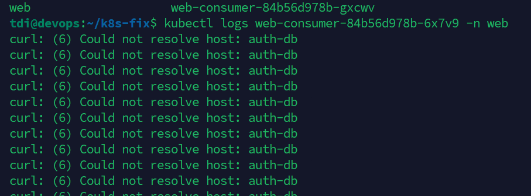
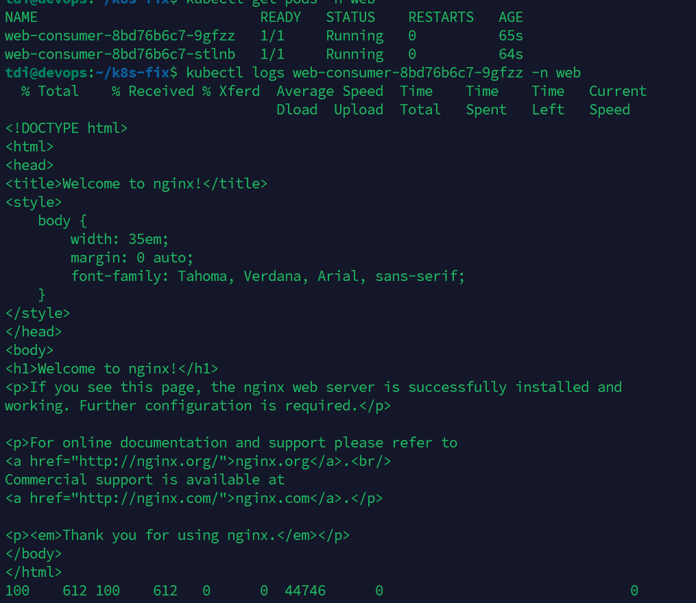

# Домашнее задание к занятию Troubleshooting

## Задание. При деплое приложение web-consumer не может подключиться к auth-db. Необходимо это исправить
1. Установить приложение по команде:
```bash
kubectl apply -f https://raw.githubusercontent.com/netology-code/kuber-homeworks/main/3.5/files/task.yaml
```
2. Выявить проблему и описать.
3. Исправить проблему, описать, что сделано.
4. Продемонстрировать, что проблема решена.

### Решение к заданию
1. С первой проблемой с которой пришлось столкнуться при развороте приложения - отсутствие namespaces для работы приложения.


2. Далее возникла проблемы совместимости образа radial/busyboxplus:curl, он не скачивался. Проблема решалась заменой на современный curlimages/curl.


3. Далее после установки приложения возникла проблема резолвингом имени между разными namespace.
Проблема решилась исправление конфигурации - прописал FQDN (auth-db.data.svc.cluster.local) для межпространственного взаимодействия.


4. После этого приложения успешно заработало.


